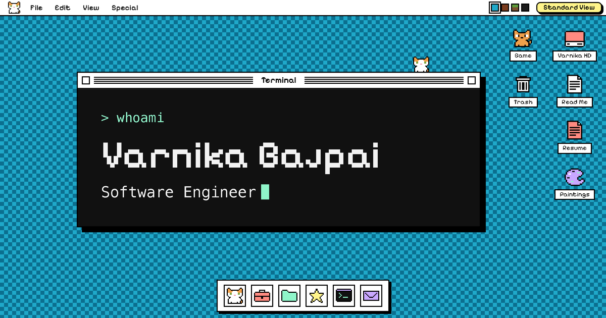

# Portfolio



Varnika Bajpai's profile site, built as a retro desktop you can explore: windows you can drag, a dock, a terminal, and four colour palettes. A regular scrolling version lives at `/standard/`.

## Commands

```bash
npm install        # install dependencies
npm run dev        # start the dev server
npm run check      # lint, type check and build
npm run e2e        # run the Playwright end-to-end tests
```

## Editing content

Everything the site says about me lives in `src/content.ts`. The desktop apps, the terminal and the Standard View all read from it, so one edit updates all three.

To add the resume download, put the PDF in `public/` and set `resumePdf` in `src/content.ts` to its file name.

## Adding an app

1. Write a component in `src/apps/`.
2. Add one entry to the `APPS` list in `src/apps/registry.ts` (title, icon, size, position, and whether it shows in the dock or on the desktop).
3. Add its id to `APP_IDS` in `src/wm/reducer.ts`.

## Project layout

| Path | What it holds |
|---|---|
| `src/content.ts` | All profile data |
| `src/wm/` | Window manager: state, drag, resize, focus |
| `src/apps/` | One component per app, plus the app registry |
| `src/shell/` | Menu bar, dock, desktop icons, intro, phone layout |
| `src/terminal/` | The terminal's command interpreter |
| `src/standard/` | The regular portfolio page |
| `src/icons/` | Pixel-art icons and the portrait |
| `e2e/` | End-to-end tests |

## Deployment

The site is served from the root of its own domain. Cloudflare builds it on each push to `main`: the build command is `npm run build` and the output folder is `dist`.

`.github/workflows/check.yml` runs the lint, the type check and the build on each push. It does not deploy.

## Analytics

`src/analytics.ts` counts actions with PostHog: which window opens, which project, the name of a terminal command, a theme change, a game, and a click on one of my links. It sends the names of actions only, never typed text. It uses no cookie.

Nothing is loaded or sent unless the build has the variable `VITE_POSTHOG_KEY` (the project key from PostHog). `VITE_POSTHOG_HOST` is optional: the default is the US host, and `https://eu.i.posthog.com` is the EU one. It is off on localhost and for a browser that asks not to be tracked.
